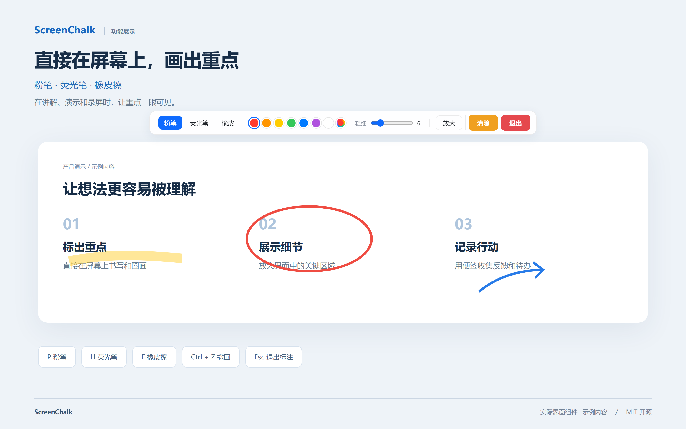
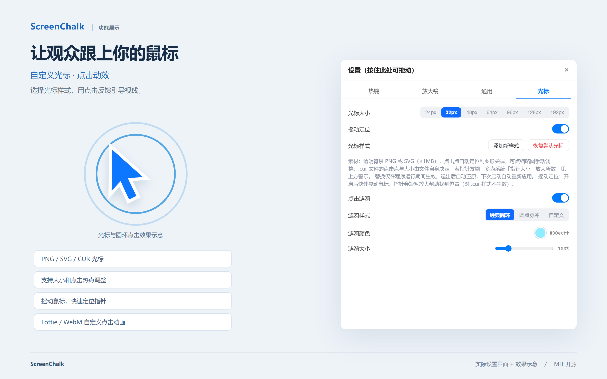

# ScreenChalk

ScreenChalk 是一款面向讲解、演示和录屏的桌面辅助工具。可以直接在屏幕上画重点、放大细节，通过鼠标点击动效引导视线，也可以随时打开置顶便签记录思路和待办。

本仓库仅维护完整产品版本，源码位于仓库根目录。

## 功能说明

以下为基于项目界面组件制作的高清功能展示图，使用示例内容；标注笔迹、放大镜和光标动效场景包含示意效果。点击图片可查看高清原图。

### 屏幕标注



- 透明置顶标注层，可在当前桌面内容上直接书写、圈画。
- 提供粉笔、荧光笔和橡皮擦三种工具。
- 支持七种预设颜色、自定义颜色，以及 2–24px 画笔粗细。
- 支持撤回最后一笔、一键清除全部笔画，以及快速退出标注模式。

### 跟随指针的放大镜


- 放大鼠标附近的屏幕内容，适合讲解小字、按钮和界面细节。
- 可调节 2–8 倍放大倍率、160–400px 镜面大小和 0–120px 指针偏移距离。
- 支持描边及描边颜色、投影和锐化开关。
- 可通过全局热键切换，也可以在标注窗口获得键盘焦点时按住空格临时放大。

### 置顶便签与待办


- 独立置顶窗口，可拖动、调整大小，并通过热键显示或隐藏。
- 支持多页便签、新建页面、双击页签重命名和删除页面。
- 文本模式支持标题、正文、有序列表和无序列表。
- 清单模式支持添加、编辑、删除待办，以及标记完成或未完成。
- 内容、窗口位置和尺寸保存在本机，便于下次继续使用。

### 自定义鼠标光标



- 导入 PNG、SVG 或 CUR 光标，保存多个样式并随时切换。
- PNG / SVG 光标支持调整显示大小，以及自动定位或手动设置点击热点。
- CUR 光标使用文件内定义的热点。
- 支持恢复系统默认光标。
- 开启“摇动定位”后，快速晃动鼠标会短暂放大指针，帮助找到位置。

### 鼠标点击动效

- 提供经典圆环和圆点脉冲效果，可调节颜色和大小，也可以关闭。
- 支持导入 Lottie JSON 或带透明通道的 WebM，自定义点击动画并在设置中预览。
- 自定义动效素材要求：240 × 240px、点击点居中、时长不超过 2 秒、文件不超过 2MB，背景透明且首尾帧全透明。

### 托盘与设置

- 左键点击系统托盘图标切换画笔模式。
- 托盘右键菜单提供画笔模式、便签、设置和退出入口。
- 设置面板分为热键、放大镜、通用和光标四个页签，支持拖动并记住位置。
- 可修改画笔、放大镜和便签的全局热键，也可设置开机自启。
- 工具设置和自定义素材保存在本机；热键与便签数据保存在应用配置目录。

## 快速使用

1. 启动应用后，通过托盘图标或 `Ctrl + Alt + F2` 进入画笔模式。
2. 在工具栏选择粉笔、荧光笔或橡皮擦，调整颜色和粗细后直接在屏幕上标注。
3. 用 `Ctrl + Alt + F3` 切换放大镜，通过设置调整倍率和样式。
4. 用 `Ctrl + Alt + F4` 打开便签，选择文本或清单模式记录内容。
5. 右键点击托盘图标打开设置，配置光标、点击动效和开机自启。

## 默认快捷键

| 快捷键 | 功能 | 使用范围 |
| --- | --- | --- |
| Ctrl + Alt + F2 | 切换画笔模式 | 全局，可修改 |
| Ctrl + Alt + F3 | 切换放大镜 | 全局，可修改 |
| Ctrl + Alt + F4 | 显示 / 隐藏便签 | 全局，可修改 |
| Ctrl + Alt + X | 强制退出应用 | 全局，不可修改 |
| P / H / E | 粉笔 / 荧光笔 / 橡皮擦 | 标注窗口获得键盘焦点时 |
| Ctrl + Z | 撤回最后一笔 | 标注窗口获得键盘焦点时 |
| 按住空格 | 临时放大，松开关闭 | 标注窗口获得键盘焦点时 |
| Esc | 退出标注模式；在便签中隐藏窗口 | 对应窗口获得键盘焦点时 |

## 平台支持

目前主要实现面向 Windows。原生放大镜、全局输入钩子和系统光标等能力包含 Windows 专用实现；macOS 放大镜目前仍是占位实现，不能视为已具备完整跨平台功能。

## 本地开发

技术栈：React 18、TypeScript、Vite 6、Tauri 2 和 Rust。

准备 Node.js / npm、Rust，以及 Windows 上的 Tauri 开发环境（Microsoft C++ 构建工具和 WebView2），然后在仓库根目录执行：

```sh
npm ci
npm run tauri dev
```

仅启动前端界面：

```sh
npm run dev
```

桌面原生能力需要通过 Tauri 运行，浏览器预览不能替代完整应用。

## 构建

```sh
# 编译前端
npm run build

# 构建桌面应用及安装包
npm run tauri build
```

前端输出目录为 `dist2/`，与 Tauri 配置一致；桌面打包产物位于 `src-tauri/target/release/bundle/`。

## 源码结构

```text
src/                 标注界面、工具栏、设置、便签和动效
src-tauri/src/       原生窗口、热键、放大镜、光标和数据保存
src-tauri/icons/     应用图标
src-tauri/tauri.conf.json  桌面应用与构建配置
```

仓库保留源码、应用图标和依赖锁文件，排除依赖目录、编译缓存与本地环境文件。

## 开源说明

ScreenChalk 采用 [MIT 许可证](LICENSE) 开源，版权归 heihu123 所有。

- 允许个人和商业使用，允许修改、复制、分发，以及在符合许可条件的情况下用于其他项目。
- 分发本软件或其重要部分时，需要保留版权声明和 MIT 许可文本。
- 软件按现状提供，不承诺特定用途的适用性，具体条款以 LICENSE 为准。
- 第三方依赖遵循各自许可证；MIT 许可不替代这些依赖的许可条款。
- 用户自行导入的光标、Lottie 和 WebM 素材不属于本项目默认提供的资源，使用与分发时应确保具有相应授权。

欢迎通过 [Issues](https://github.com/heihu123/screen-chalk/issues) 提交问题或建议，也欢迎通过 Pull Request 贡献改进。反馈问题时，请提供 Windows 版本、复现步骤、预期行为和实际结果；提交代码时请说明改动用途及验证方式。

